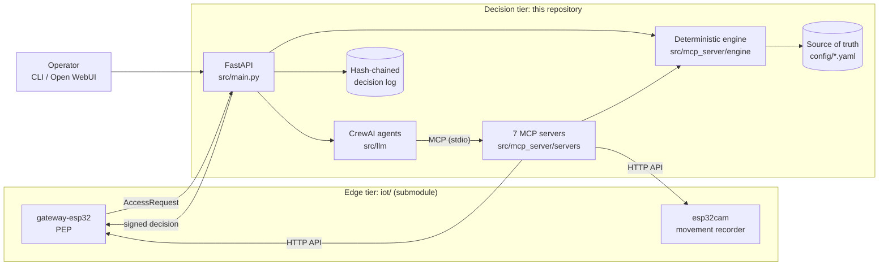

<div align="center">

# LLM Access: Multi-Agent Policy Decision for IoT Smart Gates

### Policy- and Rule-Based Access Reasoning over Standardised MCP Interfaces

</div>

---

## Overview

Smart workplaces protect their zones with network-attached gates that capture a credential and defer the decision to a central policy engine. The edge tier of this system, the *Smart Gateway* [1], implements the Policy Enforcement Point (PEP) of the NIST SP 800-162 ABAC reference model [2]. An ESP32 node captures an RFID UID and a nonce-salted PIN digest, and an ESP32-CAM independently records movement through the portal. Neither node holds organisational policy.

This repository implements the corresponding **Policy Decision Point (PDP)** and the operations layer around it. Each access request is decided by a staged reasoning pipeline. Deterministic stages (validation, identification, authentication, ABAC authorisation with XACML deny-overrides [3], and evidence-based risk) establish what is certain. A crew of language-model agents then applies natural-language guidance to live device evidence, and may only *tighten* the outcome. The same agents, organised as a hierarchical team, configure gates, recorders and policy through a plan, verify, deploy and audit workflow. The workflow follows the multi-server MCP design of the AI Network Engineer [4], and the LLM-to-MCP architecture of earlier intent-orchestration prototypes [5, 6]. This repository depends only on the devices' published HTTP contract, which keeps the decision layer separate from the enforcement layer.

---

## System Architecture



| Layer | Location | Responsibility |
|---|---|---|
| Edge firmware | `iot/` (submodule [1]) | Credential capture, actuation, motion detection, device HTTP API |
| Device adapter | `src/mcp_server/devices/` | Southbound HTTP clients for the gateway and recorder APIs |
| Engine | `src/mcp_server/engine/` | Rules, risk, correlation, verification, plans, audit log; no I/O and no LLM |
| MCP servers | `src/mcp_server/servers/` | Role-scoped tools over the engine and the devices |
| Agents | `src/llm/` | Access-review crew, operations crew, PDP service |
| Entry points | `src/main.py`, `src/cli.py` | HTTP API for gateways and operators; command line |

---

## Reasoning Model

The reasoning model is specified in [docs/reasoning.md](docs/reasoning.md). Its two parts are summarised here.

### Access Decision

```
validate -> identify -> authenticate -> authorize -> risk -> agent review -> combine -> sign
```

* **Deterministic stages** stop at the first denial. Authorisation evaluates ABAC rules (target and condition) with deny-overrides and default deny. A denial reports the first *near miss*, for example `outside_schedule` or `insufficient_clearance`.
* **Risk** joins badge and camera events into movement classes (attested transit, unattested motion, unconsummated grant) [1]. It denies on critical signals (lockdown, denial velocity) and forwards the others to the agents.
* **Agent review** runs only on a preliminary permit. An evidence analyst and an access judge apply the guidance in `config/policies.yaml` and return a structured verdict.
* **Combination** lets an agent turn a permit into a deny, never the reverse. A failure, a timeout or low confidence denies by default.
* **Fail-secure**: every error is answered with a signed deny with HTTP 200, so the gateway never falls back to its offline cache because of a PDP-side fault.

### Configuration

The orchestrator delegates to a configurator, an executor and a compliance auditor. A change reaches a device or a policy file only as a **plan** issued by the verifier, which carries a checksum, an expiry and the document version it was judged against. Policy edits are rejected if they change the outcome of any regression scenario in `config/scenarios.yaml`. The offline cache is derived so that it never grants more than the live policy would: only offline-enabled rules, two factors, and a TTL that ends with the rule's schedule window.

---

## MCP Servers

Seven servers act as the agents' operations team. Each agent connects only to the servers its role requires.

| Server | Role | Principal tools |
|---|---|---|
| `librarian` | Source of truth for site, doors and policy | `get_site_overview`, `get_door`, `get_policies`, `get_guidance` |
| `identity` | Subjects, cards, enrolment (PINs never returned) | `get_subject`, `resolve_card`, `arm_card_enrolment` |
| `verifier` | Pre-deployment validation; issues plans | `verify_gateway_config`, `verify_policy_change`, `verify_offline_acl` |
| `deployer` | Applies verified plans; rollback; overrides | `apply_plan`, `rollback_gateway`, `override_door` |
| `observer` | Live node state and movement correlation | `get_gateway_status`, `correlate_door_movements` |
| `auditor` | Compliance, anomalies, decision log | `check_compliance`, `detect_door_anomalies`, `explain_decision` |
| `simulator` | What-if requests and regression scenarios | `simulate_access`, `run_policy_scenarios` |

| Agent | Crew | Servers |
|---|---|---|
| Evidence analyst | access review | observer, auditor |
| Access judge | access review | librarian, identity, auditor |
| Orchestrator | operations (manager) | none |
| Configurator | operations | librarian, identity, verifier, simulator |
| Executor | operations | deployer, observer |
| Compliance auditor | operations | auditor, observer, simulator |

---

## Project Structure

```
llm-access/
├── src/
│   ├── main.py                 # FastAPI: PDP endpoint, operations, OpenAI-compatible chat
│   ├── cli.py                  # llm-access serve | mcp | ops | decide | scenarios | ...
│   ├── settings.py             # Environment configuration (LLM_ACCESS_*)
│   ├── llm/
│   │   ├── config/             # agents.yaml, tasks.yaml
│   │   ├── crews.py            # Access-review and operations crews (CrewAI)
│   │   ├── decision.py         # PDP service: stages, review, combine, sign, log
│   │   ├── model.py            # LLM construction
│   │   └── toolbox.py          # MCP connections with per-role least privilege
│   └── mcp_server/
│       ├── main.py             # python -m src.mcp_server.main <server>
│       ├── runtime.py          # Shared services per process
│       ├── servers/            # The seven MCP servers
│       ├── devices/            # HTTP adapter to the edge nodes
│       └── engine/             # Deterministic reasoning core
│           ├── domain/         # Typed models: access, identity, inventory, policy
│           ├── pipeline.py     # Staged decision pipeline
│           ├── rules.py        # ABAC deny-overrides evaluation
│           ├── risk.py         # Evidence-based risk signals
│           ├── correlation.py  # Badge/motion movement classes
│           ├── combine.py      # Engine and agent combination
│           ├── verifier.py     # Device and policy validation
│           ├── offline_acl.py  # Offline cache derivation
│           ├── plans.py        # Verified change plans
│           └── audit_log.py    # Hash-chained decision log
├── config/                     # Source of truth: inventory, identities, policies, scenarios
├── docs/reasoning.md           # Specification of the reasoning model
├── iot/                        # Edge firmware and hardware (git submodule) [1]
├── tests/                      # Unit and integration tests
└── pyproject.toml
```

---

## Quick Setup

### Prerequisites

* Python 3.11 to 3.13 (CrewAI does not yet support 3.14)
* An API key for the chosen LLM provider (Anthropic by default; OpenAI and Ollama are supported through the CrewAI model string)

### Installation

```bash
git clone --recurse-submodules https://github.com/CICTHackathon/llm-access.git
cd llm-access
python -m venv .venv && source .venv/bin/activate   # Windows: .venv\Scripts\activate
pip install -e ".[dev]"
cp .env.example .env                                # set the API key and device secrets
```

### Running

```bash
# Policy regression scenarios (no LLM, no devices)
llm-access scenarios

# Decide a card and PIN as the gateway would ask, without contacting devices
llm-access decide --uid 0xa1b2c3d4 --pin 1234 --door door-1 --offline

# PDP and operations API (gateways call POST /pdp/decide)
llm-access serve --port 8080

# Point a gateway at the PDP and install its secrets out of band
llm-access provision gw-1 --pdp-url http://<pdp-host>:8080/pdp/decide

# Carry out an operator intent with the operations crew (dry run by default)
llm-access ops "Sync the offline cache of door-1 and raise its PDP timeout to 25 s"

# Run one MCP server for an external MCP client
llm-access mcp observer --transport streamable-http --port 8101
```

The API documentation is served at `http://localhost:8080/docs`. The endpoint `/v1/chat/completions` (model `smartgate-ops`) is OpenAI-compatible, so the operations crew can be used from Open WebUI, as in [6].

### Testing

```bash
pytest          # engine, verifier, deployer, PDP service and API, against a simulated gateway
ruff check .
```

---

## Technology Stack

| Component | Technology | Purpose |
|---|---|---|
| Agent orchestration | CrewAI | Sequential review crew; hierarchical operations crew |
| Tool protocol | Model Context Protocol (FastMCP) | Seven role-scoped tool servers |
| LLM | Claude (default), any CrewAI-supported provider | Guidance-based review and operations reasoning |
| API | FastAPI, Uvicorn | PDP endpoint, operations, OpenAI-compatible chat |
| Models and validation | Pydantic | Typed domain, structured agent outputs |
| Edge tier | ESP32, ESP32-CAM [1] | Enforcement and movement attestation |

---

## Security Considerations

* The PDP must hold PINs to verify the nonce-salted digest. `config/identities.yaml` contains bench credentials only; a deployment should keep it in a secret store.
* Secrets are resolved from environment variables named in the inventory. They are never exposed to agents or written to plans.
* Physical actuation through agents (`override_door`) is disabled unless `LLM_ACCESS_ALLOW_ACTUATION=true`, and the gateway audits every override.
* The recorder's HTTP API is unauthenticated [1] and belongs on an isolated network.

---

## References

[1] CICT Hackathon, *Smart Gateway: ESP32 Edge Tier for Movement Attestation*, firmware, hardware and operator console. https://github.com/CICTHackathon/iot-hardware

[2] V. C. Hu *et al.*, *Guide to Attribute Based Access Control (ABAC) Definition and Considerations*, NIST SP 800-162, 2014.

[3] OASIS, *eXtensible Access Control Markup Language (XACML) Version 3.0*, OASIS Standard, 2013.

[4] Université Évry Paris-Saclay, *AI Network Engineer: Network Operations with Seven Cooperating MCP Servers*. https://github.com/evry-paris-saclay/2526-m1cns-rd-ai-network-engineer

[5] D4Gen Hackathon, *LLM-Based Intent Orchestration for Medical IoT Environments (HOPPERS)*. https://github.com/D4GenHackathon/llm-intent-orchestration

[6] D4Gen Hackathon, *LLM-Based Intent Orchestration for Medical IoT SDN-enabled Environments*. https://github.com/D4GenHackathon/onos-llm-prototype

[7] Anthropic, *Model Context Protocol Specification*. https://modelcontextprotocol.io

[8] CrewAI, *CrewAI Documentation: Agents, Tasks, Crews and MCP Integration*. https://docs.crewai.com
