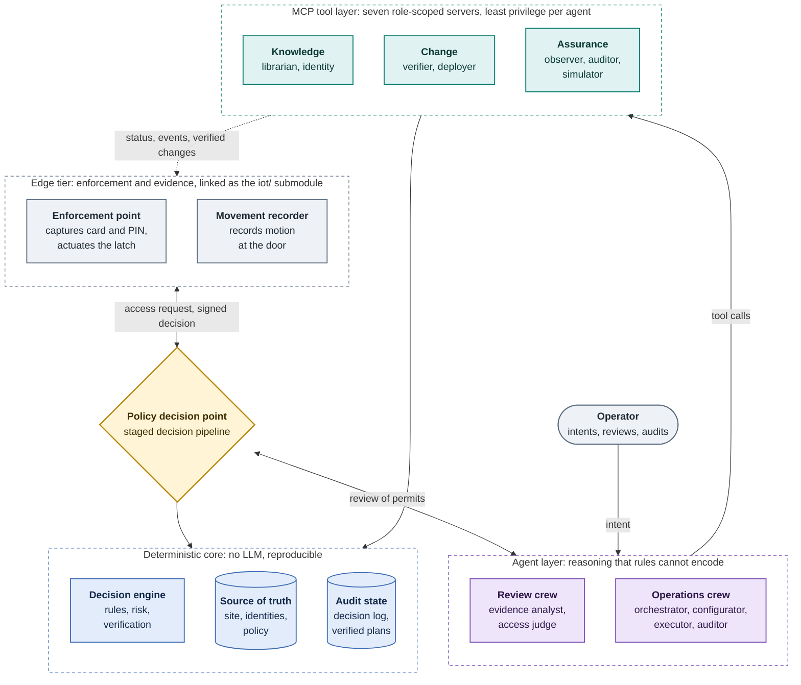
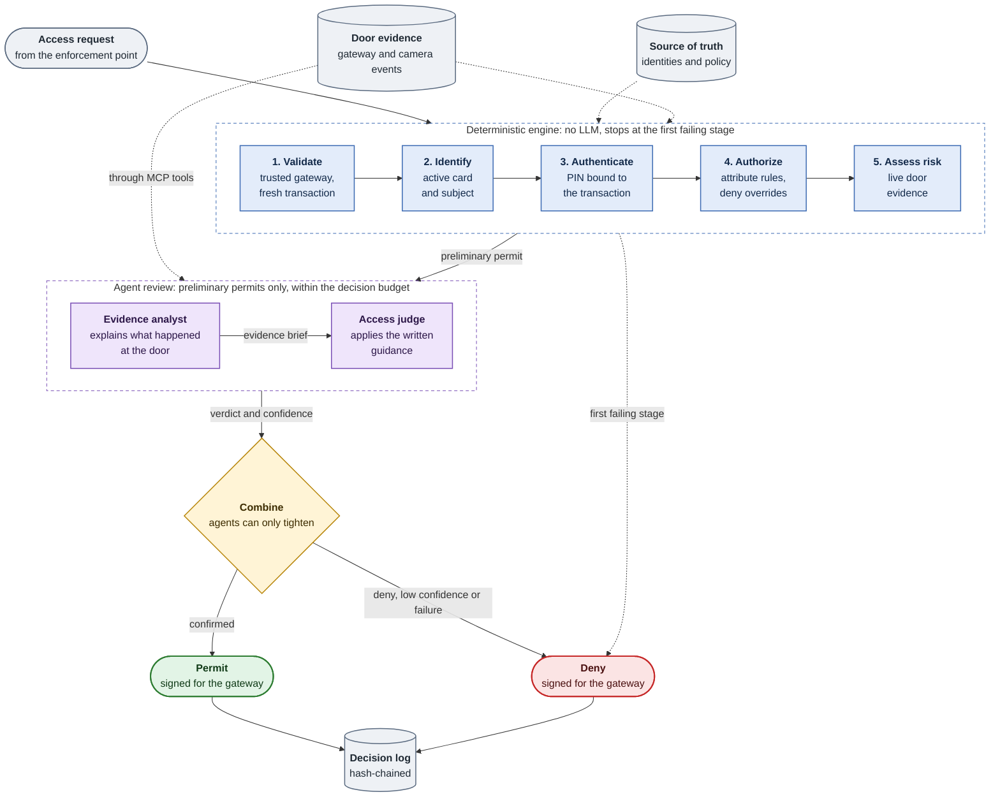
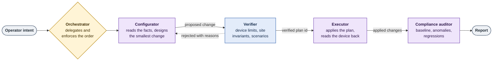

# LLM Access: Multi-Agent Policy Decision for IoT Smart Gates

*Policy- and rule-based access reasoning over standardised MCP interfaces.*

## Overview

Smart workplaces guard their zones with network-attached gates that capture a credential and defer the decision to a central policy engine. The *Smart Gateway* [1] provides this edge tier: an ESP32 node acting as the Policy Enforcement Point (PEP) of the NIST SP 800-162 ABAC model [2], which captures an RFID UID and a nonce-salted PIN digest, and an ESP32-CAM that independently records movement through the portal. Neither node holds policy.

This repository is the matching **Policy Decision Point (PDP)**. Deterministic stages (validation, identification, authentication, ABAC authorisation with XACML deny-overrides [3], and risk) establish what is certain; language-model agents then apply natural-language guidance to live evidence and may only *tighten* the outcome. The same agents configure gates, recorders and policy through a plan, verify, deploy and audit workflow, following the multi-server MCP design of [4] and the LLM-to-MCP prototypes [5, 6]. The firmware is linked as a submodule and reached only through its HTTP API, keeping the decision layer separate from the enforcement layer.

## Project Structure

```
llm-access/
├── src/
│   ├── main.py                 # FastAPI: PDP endpoint, operations, OpenAI-compatible chat
│   ├── cli.py                  # llm-access serve | mcp | ops | decide | scenarios | ...
│   ├── settings.py             # Environment configuration (LLM_ACCESS_*)
│   ├── llm/
│   │   ├── config/             # agents.yaml, tasks.yaml
│   │   ├── crews.py            # Access-review and operations crews (CrewAI)
│   │   ├── decision.py         # PDP service: stages, review, combine, sign, log
│   │   ├── model.py            # LLM construction
│   │   └── toolbox.py          # MCP connections with per-role least privilege
│   └── mcp_server/
│       ├── main.py             # python -m src.mcp_server.main <server>
│       ├── runtime.py          # Shared services per process
│       ├── servers/            # The seven MCP servers
│       ├── devices/            # HTTP adapter to the edge nodes
│       └── engine/             # Deterministic reasoning core
│           ├── domain/         # Typed models: access, identity, inventory, policy
│           ├── pipeline.py     # Staged decision pipeline
│           ├── rules.py        # ABAC deny-overrides evaluation
│           ├── risk.py         # Evidence-based risk signals
│           ├── correlation.py  # Badge/motion movement classes
│           ├── combine.py      # Engine and agent combination
│           ├── verifier.py     # Device and policy validation
│           ├── offline_acl.py  # Offline cache derivation
│           ├── plans.py        # Verified change plans
│           └── audit_log.py    # Hash-chained decision log
├── config/                     # Source of truth: inventory, identities, policies, scenarios
├── docs/reasoning.md           # Specification of the reasoning model
├── iot/                        # Edge firmware and hardware (git submodule) [1]
├── tests/                      # Unit and integration tests
└── pyproject.toml
```

## System Architecture



The decision tier is implemented in Python: the agents run on CrewAI with any supported LLM (Claude by default), the tool layer on the Model Context Protocol, and the decision interface on FastAPI.

| Layer | Location | Responsibility |
|---|---|---|
| Edge firmware | `iot/` (submodule [1]) | Credential capture, actuation, motion detection, device HTTP API |
| Device adapter | `src/mcp_server/devices/` | Southbound HTTP clients for the gateway and recorder APIs |
| Engine | `src/mcp_server/engine/` | Rules, risk, correlation, verification, plans, audit log; no I/O and no LLM |
| MCP servers | `src/mcp_server/servers/` | Role-scoped tools over the engine and the devices |
| Agents | `src/llm/` | Access-review crew, operations crew, PDP service |
| Entry points | `src/main.py`, `src/cli.py` | HTTP API for gateways and operators; command line |

## Reasoning Model

The reasoning model is specified in [docs/reasoning.md](docs/reasoning.md). Its two parts are summarised here.

### Access Decision



* **Deterministic stages** stop at the first denial. Authorisation evaluates ABAC rules (target and condition) with deny-overrides and default deny. A denial reports the first *near miss*, for example `outside_schedule` or `insufficient_clearance`.
* **Risk** joins badge and camera events into movement classes (attested transit, unattested motion, unconsummated grant) [1]. It denies on critical signals (lockdown, denial velocity) and forwards the others to the agents.
* **Agent review** runs only on a preliminary permit. An evidence analyst and an access judge apply the guidance in `config/policies.yaml` and return a structured verdict.
* **Combination** lets an agent turn a permit into a deny, never the reverse. A failure, a timeout or low confidence denies by default.
* **Fail-secure**: every error is answered with a signed deny with HTTP 200, so the gateway never falls back to its offline cache because of a PDP-side fault.

### Configuration



The orchestrator delegates to a configurator, an executor and a compliance auditor. A change reaches a device or a policy file only as a **plan** issued by the verifier, which carries a checksum, an expiry and the document version it was judged against. Policy edits are rejected if they change the outcome of any regression scenario in `config/scenarios.yaml`. The offline cache is derived so that it never grants more than the live policy would: only offline-enabled rules, two factors, and a TTL that ends with the rule's schedule window.

## MCP Servers

Seven servers act as the agents' operations team. Each agent connects only to the servers its role requires.

| Server | Role | Principal tools |
|---|---|---|
| `librarian` | Source of truth for site, doors and policy | `get_site_overview`, `get_door`, `get_policies`, `get_guidance` |
| `identity` | Subjects, cards, enrolment (PINs never returned) | `get_subject`, `resolve_card`, `arm_card_enrolment` |
| `verifier` | Pre-deployment validation; issues plans | `verify_gateway_config`, `verify_policy_change`, `verify_offline_acl` |
| `deployer` | Applies verified plans; rollback; overrides | `apply_plan`, `rollback_gateway`, `override_door` |
| `observer` | Live node state and movement correlation | `get_gateway_status`, `correlate_door_movements` |
| `auditor` | Compliance, anomalies, decision log | `check_compliance`, `detect_door_anomalies`, `explain_decision` |
| `simulator` | What-if requests and regression scenarios | `simulate_access`, `run_policy_scenarios` |

The servers fall into three groups by what they allow an agent to do: read the source of truth (`librarian`, `identity`), change the system (`verifier`, `deployer`), or check the live system (`observer`, `auditor`, `simulator`). Each agent is connected only to the groups its role needs. The review crew can therefore only read, the configurator can propose changes but not apply them, and only the executor can deploy, and only a plan the verifier has issued. The orchestrator has no tools and works by delegation alone.

| Agent | Crew | Servers |
|---|---|---|
| Evidence analyst | access review | observer, auditor |
| Access judge | access review | librarian, identity, auditor |
| Orchestrator | operations (manager) | none |
| Configurator | operations | librarian, identity, verifier, simulator |
| Executor | operations | deployer, observer |
| Compliance auditor | operations | auditor, observer, simulator |

## Quick Setup

The PDP is deployed on Ubuntu Server 22.04 LTS or 24.04 LTS, on the same network as the gateways. The commands below assume a user with `sudo` rights.

### Prerequisites

* Python 3.11 to 3.13 (CrewAI does not yet support 3.14). Ubuntu 24.04 ships Python 3.12. Ubuntu 22.04 ships 3.10, so install 3.12 from the deadsnakes PPA.
* Git, to clone the repository and its `iot/` submodule.
* An API key for the chosen LLM provider (Anthropic by default; OpenAI and a local Ollama are supported through the CrewAI model string).

```bash
sudo apt update
sudo apt install -y git python3 python3-venv python3-pip

# Ubuntu 22.04 only: Python 3.12 from deadsnakes
sudo add-apt-repository -y ppa:deadsnakes/ppa
sudo apt install -y python3.12 python3.12-venv

python3 --version        # 3.11, 3.12 or 3.13 (use python3.12 below on 22.04)
```

### Installation

```bash
git clone --recurse-submodules https://github.com/CICTHackathon/llm-access.git
cd llm-access
git submodule update --init          # only if the clone was made without --recurse-submodules

python3 -m venv .venv                # python3.12 -m venv .venv on Ubuntu 22.04
source .venv/bin/activate
pip install --upgrade pip
pip install -e ".[dev]"
```

### Configuration

```bash
cp .env.example .env
chmod 600 .env                       # the file holds the API key and the device secrets
nano .env
```

| Variable | Purpose |
|---|---|
| `ANTHROPIC_API_KEY` | Key for the default model `anthropic/claude-opus-5-5` (or set `LLM_ACCESS_LLM_MODEL` and the matching provider key) |
| `GW1_API_TOKEN`, `GW1_PDP_TOKEN`, `GW1_DECISION_KEY` | Secrets of gateway `gw-1`, as named in `config/inventory.yaml`; one set per gateway |
| `LLM_ACCESS_AGENT_REVIEW` | `on_permit` (default), `always` or `off` |
| `LLM_ACCESS_DEPLOY_MODE` | `live`, or `dry_run` to record plans without touching devices |

The device secrets are generated by the operator, for example with `openssl rand -hex 24`. `GW1_API_TOKEN` is the token the gateway prints on its serial console at first boot [1]. The node addresses in `config/inventory.yaml` must match the gateways and recorders on the network.

### Running

```bash
source .venv/bin/activate

# Policy regression scenarios (no LLM, no devices)
llm-access scenarios

# Decide a card and PIN as the gateway would ask, rules only and without contacting devices
llm-access decide --uid 0xa1b2c3d4 --pin 1234 --door door-1 --offline --no-agents

# The same request with the agent review (requires the API key)
llm-access decide --uid 0xa1b2c3d4 --pin 1234 --door door-1 --offline

# PDP and operations API (gateways call POST /pdp/decide)
llm-access serve --host 0.0.0.0 --port 8080

# Point a gateway at the PDP and install its secrets out of band
llm-access provision gw-1 --pdp-url http://<pdp-ip>:8080/pdp/decide

# Check every node against the security baseline
llm-access compliance

# Carry out an operator intent with the operations crew (dry run unless --live)
llm-access ops "Sync the offline cache of door-1 and raise its PDP timeout to 25 s"

# Run one MCP server for an external MCP client
llm-access mcp observer --transport streamable-http --port 8101
```

The API documentation is served at `http://<pdp-ip>:8080/docs`.

### Running as a Service

The PDP must keep running for the gates to work, so in deployment it runs under systemd as an unprivileged user. Install the repository in `/opt/llm-access` as described above, then:

```bash
sudo useradd --system --home /opt/llm-access --shell /usr/sbin/nologin llmaccess
sudo chown -R llmaccess:llmaccess /opt/llm-access

sudo tee /etc/systemd/system/llm-access.service > /dev/null <<'UNIT'
[Unit]
Description=LLM Access - Smart Gateway PDP
After=network-online.target
Wants=network-online.target

[Service]
User=llmaccess
WorkingDirectory=/opt/llm-access
ExecStart=/opt/llm-access/.venv/bin/llm-access serve --host 0.0.0.0 --port 8080
Restart=on-failure
RestartSec=3

[Install]
WantedBy=multi-user.target
UNIT

sudo systemctl daemon-reload
sudo systemctl enable --now llm-access
systemctl status llm-access
journalctl -u llm-access -f          # one log line per decision
```

The service reads `.env` from its working directory. Runtime state (decision log, plans, configuration revisions) is written to `/opt/llm-access/var/`.

Allow the gateways, and only them, to reach the PDP. The example assumes the gateways are on `192.168.1.0/24`:

```bash
sudo ufw allow from 192.168.1.0/24 to any port 8080 proto tcp
sudo ufw enable
```

### Operator Chat (optional)

The endpoint `/v1/chat/completions` (model `smartgate-ops`) is OpenAI-compatible, so the operations crew can be used from Open WebUI, as in [6]:

```bash
sudo apt install -y pipx && pipx ensurepath
pipx install --python python3.12 open-webui
open-webui serve --port 3000
```

In Open WebUI, add an OpenAI API connection with base URL `http://localhost:8080/v1` and select the model `smartgate-ops`.

### Testing

```bash
pytest          # engine, verifier, deployer, PDP service and API, against a simulated gateway
ruff check .
```

## Security Considerations

* The PDP must hold PINs to verify the nonce-salted digest. `config/identities.yaml` contains bench credentials only; a deployment should keep it in a secret store.
* Secrets are resolved from environment variables named in the inventory. They are never exposed to agents or written to plans.
* Physical actuation through agents (`override_door`) is disabled unless `LLM_ACCESS_ALLOW_ACTUATION=true`, and the gateway audits every override.
* The recorder's HTTP API is unauthenticated [1] and belongs on an isolated network.

## References

[1] CICT Hackathon, *Smart Gateway: ESP32 Edge Tier for Movement Attestation*, firmware, hardware and operator console. https://github.com/CICTHackathon/iot-hardware

[2] V. C. Hu *et al.*, *Guide to Attribute Based Access Control (ABAC) Definition and Considerations*, NIST SP 800-162, 2014.

[3] OASIS, *eXtensible Access Control Markup Language (XACML) Version 3.0*, OASIS Standard, 2013.

[4] Université Évry Paris-Saclay, *AI Network Engineer: Network Operations with Seven Cooperating MCP Servers*. https://github.com/evry-paris-saclay/2526-m1cns-rd-ai-network-engineer

[5] D4Gen Hackathon, *LLM-Based Intent Orchestration for Medical IoT Environments (HOPPERS)*. https://github.com/D4GenHackathon/llm-intent-orchestration

[6] D4Gen Hackathon, *LLM-Based Intent Orchestration for Medical IoT SDN-enabled Environments*. https://github.com/D4GenHackathon/onos-llm-prototype

[7] Anthropic, *Model Context Protocol Specification*. https://modelcontextprotocol.io

[8] CrewAI, *CrewAI Documentation: Agents, Tasks, Crews and MCP Integration*. https://docs.crewai.com
