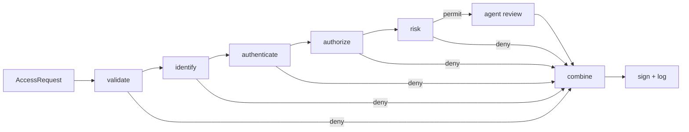
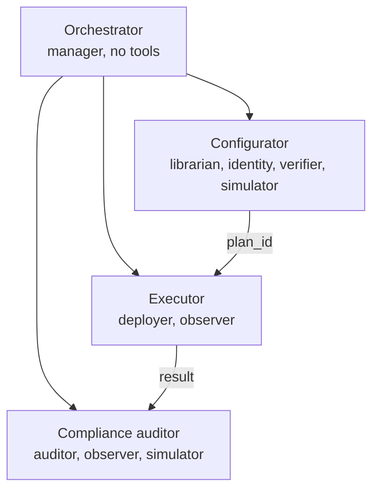

# Reasoning Model

This document specifies how the system reasons about the two problems it solves: **deciding an individual access request** at a smart gate, and **configuring** the gate, its recorder and the policy behind them. Both follow one design principle: deterministic code establishes what is certain, and the language-model agents are confined to the judgement that rules cannot encode. An agent can always make an outcome stricter and can never make it looser.

---

## 1. Access Decision

### 1.1 Protocol

The enforcement node (PEP) captures a card UID and a PIN and POSTs an `AccessRequest` to its configured `pdpUrl` [1]:

```json
{"txn": "9f2c4e1a7b3d5c60", "door": "door-1", "uid": "0xa1b2c3d4",
 "pinDigest": "<SHA-256(txn:pin)>", "pinSalt": "txn", "epoch": 1794298200, "rssi": -61}
```

The PIN never leaves the node in clear text. It is salted with the per-transaction nonce `txn`, so a captured digest cannot be replayed into another transaction. The PDP answers with a flat document that the firmware parses field by field:

```json
{"txn": "9f2c4e1a7b3d5c60", "effect": "permit", "reason": "R-STAFF-DEPT",
 "sig": "<HMAC-SHA256(decisionKey, txn|effect)>"}
```

The gateway accepts a decision only for the transaction it has in flight, and only with a valid signature [1]. The `reason` is limited to 23 characters, with no comma, quote or brace.

### 1.2 Pipeline



| Stage | Question answered | Deny codes |
|---|---|---|
| validate | Is the caller the door's gateway, is the request fresh and unseen? | `pep_unauthorized`, `unknown_door`, `replayed_txn`, `stale_request` |
| identify | Does the card belong to an active subject? | `unknown_card`, `card_revoked`, `card_expired`, `subject_inactive`, `subject_expired` |
| authenticate | Does `SHA-256(txn:pin)` match the digest sent? | `pin_required`, `no_pin_enrolled`, `pin_mismatch` |
| authorize | Do the ABAC rules permit this subject at this door now? | a deny rule id, or the first near miss (`outside_schedule`, `insufficient_clearance`, ...) |
| risk | Does live evidence forbid it outright? | `door_lockdown`, `denial_velocity` |
| agent review | Does natural-language guidance, applied to the evidence, still allow it? | the agent's code, `agent_low_confidence`, `agent_unavailable` |

The pipeline stops at the first failing stage. It runs once on local evidence. Only a request that reaches a permit causes a second pass with device evidence (gateway audit ring, camera events), so most denials cost no network round trip.

### 1.3 Authorization (ABAC)

Rules follow the attribute-based model of NIST SP 800-162 [2] and are combined **deny-overrides with default deny**, as in XACML 3.0 [3]:

1. If any applicable rule has effect `deny`, the request is denied.
2. Otherwise, if any applicable rule has effect `permit`, it is permitted.
3. Otherwise it is denied.

A rule applies when its *target* covers the door (by zone, door or `any`) and every clause of its *condition* holds. Clauses are evaluated in a fixed order: who the subject is (roles, department, clearance, attributes) before when they arrive (schedule). A near miss therefore reports `outside_schedule` only for a subject who would otherwise have been admitted. The access judge relies on this distinction, for example in guidance G-PROBING, where denials caused by a closed window are not treated as probing.

### 1.4 Risk Signals

Risk is computed deterministically from evidence collected within the decision budget:

| Signal | Severity | Source |
|---|---|---|
| `door_lockdown` | critical | source of truth |
| `denial_velocity` | critical | decision log: at least `max_recent_denials` for the card in the window |
| `unattested_motion` | warn | camera motion with no credential within ±`correlation_window_s` [1] |
| `bad_signature`, `remote_unlock`, `tamper` | warn | gateway audit ring |
| `gateway_clock_unset`, `unsigned_decisions` | warn | gateway status |
| `unconsummated_grant`, `pin_lockout`, `correlation_unavailable`, `evidence_unavailable` | info | joined evidence |

Critical signals deny. Warning and info signals are passed to the agents. Movement classes reproduce the operator console's timeline join [1], except that camera events the on-device cascade rejected as non-human are excluded.

### 1.5 Agent Review

A sequential crew of two agents runs only on a preliminary permit:

* **Evidence analyst** (observer and auditor tools): turns the risk signals into a factual brief, calling tools only when a signal needs detail.
* **Access judge** (librarian, identity and auditor tools): applies each guidance statement to the brief and returns a structured `AgentVerdict` with effect, confidence, code, reasons and cited guidance ids.

Both agents receive the full stage trace and run under the remaining decision budget, so the review cannot stall the gate.

### 1.6 Combination

| Engine | Review | Final |
|---|---|---|
| deny | any (advisory only) | deny |
| permit | none requested | permit |
| permit | permit with confidence at or above the threshold | permit |
| permit | permit with confidence below the threshold | deny `agent_low_confidence` |
| permit | deny | deny with the agent's code |
| permit | failure or timeout | deny `agent_unavailable` (mode `deny`) or permit (mode `rules`) |

### 1.7 Fail-Secure Properties

* Every error, including a malformed request, gets HTTP 200 with a signed deny. A non-200 status would push the gateway into its degraded path, where the offline cache would decide instead [1].
* Every decision is appended to a hash-chained log, whose integrity can be checked at `GET /pdp/integrity`.
* The budget (`LLM_ACCESS_DECISION_BUDGET_S`, default 20 s) must be shorter than the gateway's `pdpTimeoutMs` (at most 30 s). The verifier and the auditor both enforce this.

---

## 2. Configuration

### 2.1 Workflow

Configuration follows the workflow of the AI network engineer team [4]: gather, plan, verify, deploy, validate. It is carried out by a hierarchical crew:



The orchestrator has no tools and only delegates. Specialists communicate through task context and through plan ids, which are the only artefacts that cross from configuration to execution.

### 2.2 Plans

A change reaches a device or a policy file only as a **plan**:

1. The configurator proposes a change to the verifier.
2. The verifier validates it and, if no error remains, writes a plan with a checksum, an expiry (15 min) and the version of the document it was judged against.
3. The executor applies the plan by id. The deployer re-checks status, expiry, checksum and base version, records the previous device state, applies the change, and reads the device back to confirm it.

An agent therefore cannot deploy a change the verifier has not seen, cannot change a plan after verification, and cannot apply a plan against a policy that has since changed.

### 2.3 Verification Rules

| Change | Checks |
|---|---|
| gateway config | firmware ranges (refused, not clamped), servo angles differ, `requirePin` kept where policy requires it, `doorId` matches the inventory, `pdpTimeoutMs` covers the decision budget, secrets refused |
| camera config | firmware ranges; warnings on disabled evidence or slow triggers |
| policy edit | schema, known targets, no unconditional or untargeted permit, and **every regression scenario re-run against the candidate policy** |
| credential edit | referential integrity, no reassignment of an active card, scenarios re-run |
| offline ACL | see 2.4 |

A violation already present on a device is reported as a warning, so it does not block an unrelated change. A change that would introduce the violation is an error.

### 2.4 Offline Authorisation Cache

During a PDP outage the gateway decides from a cached set of entries, each holding a UID, `SHA-256(uid:pin)` and a TTL [1]. The cache cannot evaluate schedules, deny rules or risk, so the configurator derives it as follows:

* include only subjects who are permitted **now** by a rule marked `offline_cache`, and to whom no deny rule applies;
* exclude card-only credentials, which would make offline mode single-factor;
* set each TTL to the time the permission would keep holding on its own: the end of the rule's schedule window, capped by the default TTL and by credential or subject expiry;
* refuse more entries than the gateway's 16 slots, and any cache on a door in lockdown.

### 2.5 Secrets

API tokens, PDP tokens and decision keys are never sent to an agent or written to a plan. The inventory names the environment variables that hold them, and the operator command `llm-access provision` installs them on a gateway out of band.

---

## References

[1] CICT Hackathon, *Smart Gateway: ESP32 Edge Tier for Movement Attestation*. https://github.com/CICTHackathon/iot-hardware

[2] V. C. Hu *et al.*, *Guide to Attribute Based Access Control (ABAC) Definition and Considerations*, NIST SP 800-162, 2014.

[3] OASIS, *eXtensible Access Control Markup Language (XACML) Version 3.0*, OASIS Standard, 2013.

[4] Université Évry Paris-Saclay, *AI Network Engineer: seven MCP servers for network operations*. https://github.com/evry-paris-saclay/2526-m1cns-rd-ai-network-engineer
